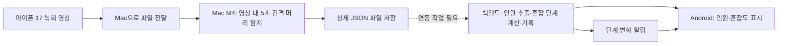

# Campus Pulse

> 5공학관 식당의 사람 머리 수를 분석해 혼잡도를 보여주고, 단계 변화를 알려주는 Android 앱

**2026 첨단 AI 해커톤 · 4인 팀 · 정리 기준: 2026년 11월 6일 (KST)**

개발 기간: 2026년 11월 5일 16:30 ~ 11월 6일 11:30

최종 분석 범위는 **머리 탐지 → 인원 추정 → 원활·보통·혼잡 분류**입니다. 좌석 점유, 빈자리 계산, 짐 탐지와 일시 비움 처리는 제외했습니다. 이 문서는 최신 합의와 현재 로컬 작업 폴더에서 확인한 구현 상태를 구분해 기록합니다. `develop`의 백엔드 1차 구현을 로컬 `main`에 병합했습니다. 실제 배포·DB·Android 통합 상태는 별도 확인이 필요합니다.

[AI 담당 안내](ai/README.md) · [백엔드 담당 안내](backend/README.md) · [Android 담당 안내](frontend/README.md) · [영상 실행 방법](docs/head_video_input.md) · [Mac 학습 안내](docs/training_mac.txt)

## 확정한 범위

| 항목 | 결정 |
| --- | --- |
| 대상 | **5공학관 식당 한 곳** |
| 핵심 지표 | 영상의 관측 범위에서 탐지한 머리 수 `head_count` |
| 혼잡도 | 머리 수 기준 0–21 **여유**, 22–100 **보통**, 101 이상 **포화** |
| 촬영 장비 | **iPhone 17** |
| AI 장비 | **Mac M4**, Python 3.12, PyTorch MPS |
| 시연 입력 | 미리 녹화한 영상 파일을 Mac으로 옮겨 분석 |
| 분석 간격 | **영상 시간 기준 5초**: 0초, 5초, 10초… |
| 서비스 | **Android 앱**에서 인원·혼잡도 조회, 단계 상승·하락 알림 |
| 출력 방침 | AI 상세 JSON 유지, 백엔드에서 필요한 필드 추출 |
| 배포 방향 | 백엔드 Cloudflare. Android 빌드·설치는 앱 담당 |
| 제외 | 도서관·다른 시설, 좌석·짐 분석, 빈자리 안내, 자리 예약·복귀 판단 |

식당은 팀이 확인한 **300석 규모**입니다. 현재 혼잡 단계는 AI가 검출한 머리 수로 계산합니다: 0–21 여유, 22–100 보통, 101 이상 포화. 검출 머리 수는 실제 식당 전체 인원·좌석 점유와 같다고 보장하지 않습니다.

실시간 송출 대신 녹화 파일 분석으로 시연합니다. 방문 시간 예측·대체 장소 추천은 현재 필수 시연 범위에 포함하지 않습니다.

## 시연 시나리오와 구현 경계



1. 식당의 고정 구도에서 영상을 촬영하고 Mac으로 전달합니다.
2. AI가 영상의 0·5·10초 등 각 경계에 도달한 첫 프레임을 분석합니다.
3. 프레임별 `head_count`와 탐지 상세 결과를 JSON으로 저장합니다.
4. 백엔드 담당자가 결과를 읽어 필요한 필드를 추출하고, 합의한 인원 기준으로 혼잡도를 계산합니다.
5. Android 앱이 결과를 표시하고, 확정된 혼잡 단계가 올라가거나 내려가면 알림을 받습니다.

AI CLI는 녹화 영상 분석 결과를 JSON으로 저장하고, 선택적으로 완료된 JSON을 백엔드에 업로드할 수 있습니다. 백엔드는 기존 `head-video-v1`과 새 `observations[]` 입력을 모두 받으며, 앱은 API의 마지막 인원수와 계산된 혼잡도를 표시합니다. 운영 배포와 실기기 알림 검증은 별도 완료가 필요합니다.

사용자가 정한 시연 갱신 간격은 5초입니다. 현재 CLI의 5초는 **영상 속 분석 간격**이며, 실제 시간으로 5초씩 기다려 전송하는 기능은 아닙니다. 시연에서 결과를 5초마다 갱신하려면 영상 시각에 맞춰 결과를 전달·표시하는 연동을 추가해야 합니다. 녹화 결과는 앱에서 실시간 현황과 구분합니다.

## 앱에 표시할 정보와 알림

| 항목 | 표현할 내용 |
| --- | --- |
| 시설 | 5공학관 식당 |
| 감지 인원 | 선택한 관측 시점의 `head_count`명과 관측 범위 |
| 혼잡도 | 원활 / 보통 / 혼잡. 분석 오류·미수신은 확인 불가로 구분 |
| 시각 | 녹화 영상 내 시각, 분석 결과 생성 시각을 구분 |
| 시연 상태 | 녹화 영상 기반 분석임을 표시 |
| 알림 설정 | 수신 ON/OFF, 완화·악화·양방향 선택 |
| 선택 표현 | 혼잡 단계에 비례하는 사람 캐릭터 효과 |

알림은 `HIGH → MEDIUM/LOW` 또는 `MEDIUM → LOW`로 혼잡 단계가 내려갈 때 발송됩니다. 알림 선호도와 이력은 기기/서버에 저장됩니다. Android 실기기 수신에는 Expo 프로젝트의 Firebase FCM V1 자격 증명 설정이 필요합니다. 녹화 영상은 분석 완료 후 한 번 업로드되므로 현재 안내값은 라이브 현황이 아닙니다.

## AI 출력과 백엔드의 역할

모델의 탐지 상세 필드는 유지하고, AI 실행 스크립트가 프레임별 인원과 영상 메타데이터를 함께 저장합니다. **앱에 필요한 값은 백엔드에서 추출하는 방식**으로 정했습니다. 좌표를 없애기 위해 모델을 다시 학습할 필요는 없습니다.

| 실제 영상 JSON 필드 | 의미 |
| --- | --- |
| `schema_version` | `head-video-v1` |
| `input_type` | `recorded_video` |
| `video_name` | 입력 파일명. 고유 영상 ID는 아님 |
| `sample_interval_seconds` | 분석 간격, 기본 5초 |
| `images[].frame_index` | 디코딩한 프레임의 0부터 시작하는 번호 |
| `images[].video_time_seconds` | 영상 시작 기준 상대 시각 |
| `images[].head_count` | 해당 프레임에서 탐지한 머리 수 |
| `images[].detections` | 머리별 `name`, `class`, `confidence`, `box` |
| `analyzed_at` | JSON 생성 시각, UTC ISO 8601 |
| `analyzed_frame_count`, `decode_check` | 분석한 프레임 수와 디코딩 검사 상태 |

전체 필드와 오류 처리는 [영상 JSON 명세](docs/head_video_input.md), 사진 출력은 [사진 JSON 명세](docs/head_output.md)를 기준으로 합니다.

- 현재 인원 키는 **`head_count`**이며 `count`가 아닙니다. `head_count == len(detections)`입니다.
- 여러 프레임의 수를 더해 현재 인원이나 누적 방문자 수로 사용하지 않습니다.
- 촬영 범위 밖이나 가려진 사람까지 포함하는 식당 전체 인원으로 단정하지 않습니다. 여러 카메라의 값도 중복 해결 없이 합산하지 않습니다.
- 유효한 프레임의 탐지 0건과 영상 읽기·분석 실패는 다릅니다. 탐지 0건도 모델이 놓친 사람 없는지 검증해야 합니다.
- `analyzed_at`은 실제 촬영 시각이 아닙니다. `video_time_seconds`도 날짜·시각이 아닌 상대 시간입니다.
- 시설 ID, 분석 실행 ID, 수신 시각, 혼잡 단계, 알림 이벤트는 **현재 AI JSON 필드가 아닙니다.** 백엔드 연동 때 관리할 메타데이터와 응답 형식을 합의합니다.

## 구현 완료된 것과 성능 한계

| 항목 | 현재 확인 상태 |
| --- | --- |
| Python 3.12 / MPS 환경 | Mac M4에서 설치·기본 연산·시험 학습 확인 |
| CVAT 자체 촬영 자료 | train 16장·64개 머리, val 4장·15개 머리 준비 |
| AI Hub 실내 자료 병합 | train 83장·1,882개, val 81장·1,882개 머리 박스 준비 |
| 모델 학습 | 3 epoch 시험 학습 2회, 타일·배경 보완 각 5 epoch, 이후 10 epoch·식당 비중 조정 8 epoch 추가 실험 완료 |
| 타일·배경 학습 자료 | 최종 train 180장·2,045개 박스, val 81장·1,882개. 기존 train 파생 타일 80장과 머리 없는 배경 17장 포함 |
| 사진 분석 | 상세 JSON, `head_count`, 선택적 타일 분석 구현 |
| 녹화 영상 분석 | 5초 간격 프레임 선택·MPS 추론·상세 JSON 저장 구현 |
| 영상 경로 시험 | 사람이 없는 합성 영상 121프레임에서 0·5·10초 결과 3건 확인 |
| 실제 iPhone 영상 | 파일 전달 후 디코딩·회전·현장 탐지 성능 확인 필요 |
| 백엔드 | Cloudflare Worker의 관측·시설·구독·알림 이력 API, D1 저장, 인원수 기반 혼잡도·Expo 푸시 |
| Android 앱 | 혼잡도 화면, 저장형 알림 설정, 기기 푸시 토큰 구독, 알림 내역 화면 |

식당 검증 사진 4장의 정답 머리 수는 **[2, 3, 5, 5]**입니다. 같은 타일 추론 조건에서 기존 모델은 **정탐 3·오탐 1·누락 12**, 추가 학습 후 선택한 모델은 **정탐 11·오탐 2·누락 4**였습니다. 박스 IoU 0.5 기준 재현율은 20.0% → 73.3%, F1은 0.316 → 0.786입니다. 인원 출력은 **[3, 2, 4, 4]**, 사진당 인원 절대오차 평균은 1.0명입니다. 오탐과 누락이 상쇄될 수 있으므로 인원 오차와 박스 매칭을 함께 평가했습니다.

후속 10 epoch·식당 비중 조정 8 epoch 실험과 추론 설정 비교도 완료했습니다. 현재 실험에서 선택한 가중치는 `runs/head/indoor_hardneg_20261106_01/weights/best.pt`를 유지하며, **2048픽셀 타일·입력 1280·겹침 0.2·conf 0.10·NMS IoU 0.7** 설정에서 정탐 11·오탐 1·누락 4, 재현율 **73.3%**, F1 **0.815**, 인원 MAE **0.75명**이었습니다. 목표 재현율 90%·F1 0.87에는 미달했습니다. 이는 위 동일 설정의 학습 비교와 별도로 추론 설정을 조정한 결과입니다.

학습·설정 선택에 사용하지 않은 사용자 사진(480×270)에서는 **5개를 탐지**했습니다. 육안상 약 13개의 머리가 보여 새 장면의 누락이 크며, 정식 라벨이 없어 이 사진의 F1·재현율은 계산하지 않았습니다. 자세한 비교와 사진 결과는 [추가 학습·테스트 기록](docs/head_extension_20261106.md), 앞선 개선 과정은 [머리 탐지 개선 기록](docs/head_improvement_20261106.md)에 있습니다. 외부 실내 자료가 섞인 검증 점수를 식당 정확도로 표현하지 않습니다.

평가에 사용한 식당 4장은 모델 선택용 검증 자료입니다. 최종 성능을 확인할 별도 테스트 영상은 추가로 확보해야 합니다. 타일은 기존 사진에서 파생한 학습 자료이며 독립적인 새 촬영 장면이 아닙니다.

## develop 병합 후 연동 차이

백엔드 구현은 들어왔지만 현재 AI 결과를 바로 보내는 단계는 아닙니다. **팀원 백엔드 코드는 수정하지 않고 병합했으며**, 다음 변경은 백엔드 담당자가 진행합니다.

| 항목 | 병합된 백엔드 코드 | 최신 목표와 남은 작업 |
| --- | --- | --- |
| 입력 | 기존 `head-video-v1` 상세 JSON | `observations[]`의 `video_time_seconds`, `head_count` 형식도 수용. 각 배열 순서대로 저장 |
| 혼잡 단계 | AI 요청에는 단계 필드가 없음 | 마지막 `head_count`를 0–21/22–100/101+ 구간으로 백엔드에서 계산 |
| 시간 | 절대 `captured_at`과 최신성 검증 사용 | 녹화 상대시각·분석시각·시연 재생시각의 처리 합의 |
| 알림 | `HIGH → MEDIUM/LOW`만 발송. 기존 빈자리 문구 사용 | 완화·악화 방향, 구독 설정과 머리 수 기준 문구로 변경 |
| 저장·배포 | D1 ID와 Worker 설정 존재 | 0003·0004 원격 마이그레이션, Worker 재배포, 실데이터 수신 확인 필요 |

병합 검증으로 **Wrangler `--dry-run` 번들 생성**을 확인했습니다. 원격 배포·DB 변경·푸시 전송은 하지 않았으며, 이는 API 통합 테스트나 TypeScript 전체 타입 검사 통과를 뜻하지 않습니다. 현재 코드의 API·설정과 계약 차이는 [Backend README](backend/README.md)를 참고합니다.

## 데이터와 학습 방향

[AI Hub 실내외 군중 특성 데이터 71368](https://www.aihub.or.kr/aihubdata/data/view.do?aihubDataSe=data&dataSetSn=71368)의 제공 샘플 중 **2세부 실내 머리 박스**를 변환하고 자체 촬영 자료와 병합했습니다. 외부 카페 장면은 학습, 공연장 장면은 검증으로 분리했습니다. 구성 근거와 재현 명령은 [실내 데이터 준비 기록](docs/aihub71368_sample.md)에 있습니다.

- 학습 클래스는 `0=head` 하나입니다. 자체 촬영 사진은 CVAT Online에서 머리 박스로 라벨링합니다.
- 원본은 보존하고 변환된 사본을 사용합니다. 영상·장면 단위로 학습·검증·테스트를 분리하고 인접 프레임의 누출을 피합니다.
- 기존 YOLOv8n 구조와 사전학습 가중치를 미세조정했습니다. 무작위 초기화 학습이나 새로운 모델 구조 개발을 완료한 것은 아닙니다.
- 자체 자료와 외부 자료의 이용 조건, 대회 외부 데이터·사전학습 허용 범위는 팀에서 확인합니다. 원본 데이터와 모델 파일은 Git 제외 대상입니다.

## 팀 역할과 폴더

담당자 이름은 기존 기획서 초안 기준입니다. 좌석 분석 제외에 따른 AI 두 사람의 세부 재배분은 팀에서 확정합니다.

| 담당 | 폴더 | 현재 범위에서의 작업 |
| --- | --- | --- |
| 변민석·구태웅 | [ai](ai/README.md) | 머리 라벨·학습·현장 평가, 영상 입력·5초 샘플링, 상세 JSON 생성·연동 자료 제공 |
| 김경렬 | [backend](backend/README.md) | JSON 필드 추출, 혼잡 단계 계산, 기록·조회 API, 결과 재생·갱신, 단계 변화·푸시 발송 |
| 김민정 | [frontend](frontend/README.md) | Android 인원·혼잡도 화면, 시각·상태 표시, 알림 설정·권한·수신 |

`frontend` 폴더명은 유지합니다. **백엔드 구현은 백엔드 담당자가 진행하며, AI 작업에서 백엔드 코드를 추가하거나 변경하지 않습니다.**

```text
campus_pulse/
├── ai/                       # 데이터 준비·학습·사진 및 영상 추론
├── backend/                  # Worker API 1차 구현·D1 스키마·담당 안내
├── frontend/                 # Android 앱 담당 안내
├── docs/                     # 학습·출력 형식·검증 기록
├── scripts/check_environment.py
├── pyproject.toml
├── uv.lock
├── requirements.txt
├── package.json              # Cloudflare 도구
└── README.md
```

## 앞으로 할 일

1. **실제 iPhone 녹화 파일 확인:** Mac에서 영상 열기·회전·시각·5초 간격 출력을 확인합니다.
2. **머리 탐지 현장 확인:** 추가 학습과 기존 모델 비교는 완료했습니다. 선택한 모델·타일 설정으로 실제 녹화 영상의 작은 머리·가림·배경 오탐을 확인합니다.
3. **현장 테스트 확보:** 11월 6일 오전 8시 이후 확보 가능한 실제 혼잡 영상을 활용합니다. 최종 테스트로 남길 장면은 학습에서 제외하고 수작업 머리 수와 비교합니다.
4. **혼잡 기준 확정:** 관측 범위를 정하고 원활·보통·혼잡의 인원 임계값, 변화 지속 조건을 합의합니다.
5. **백엔드 연동:** 실제 JSON 샘플 전달, 결과 수신·저장·조회와 5초 갱신 시연 방식을 백엔드 담당자가 구현합니다.
6. **Android 통합:** 인원·상태 표시, 증가·감소 알림, 최초·오류·지연·재생 초기화 상황을 확인합니다.
7. **마감 전 점검:** 실제 영상·학습 결과와 예시 데이터를 구분하고 통합 시연·발표를 검증합니다.

## 저장소와 개발 환경

```bash
git clone https://github.com/rnxodnd/campus_pulse.git
cd campus_pulse
```

기존 저장소의 로컬 `main`에서 팀원 변경을 받을 때는 `git status`로 수정 내용을 확인한 뒤 `git pull --ff-only origin main`을 사용합니다. 수정 중인 파일이나 분기 상태는 먼저 정리하고 다른 팀원의 변경을 덮어쓰지 않습니다.

## 개발 환경

AI 학습·추론용 팀 공통 Python 버전은 **3.12**입니다. 아래 파일로 패키지 버전을 공유하며, 필요한 담당자는 자신의 컴퓨터에서 저장소 최상위에 `.venv`를 생성합니다. `ai` 폴더로 역할을 나눴다고 가상환경을 폴더마다 만들 필요는 없습니다. **Android 앱 개발 환경은 별도**이며 프레임워크, SDK·빌드 도구와 서명·설치 방식은 미정입니다.

| 구분 | 구성 | 용도 |
| --- | --- | --- |
| 학습 장비 | Apple Silicon M4 Mac | 모델 학습 및 시연 영상 추론 |
| 실행 장치 | Mac: MPS / GPU 없는 Windows 그램: CPU | 장비별 연산 장치 |
| 언어 | Python 3.12 | 데이터 처리, 학습, 추론 |
| 환경 관리 | `.venv`, pip 또는 uv | 패키지 격리 및 의존성 관리 |
| 딥러닝 | PyTorch 2.9.1, torchvision 0.24.1 | 학습 및 추론 |
| 탐지 프레임워크 | Ultralytics 8.3.253 | YOLOv8 기반 모델 실험 |
| 영상·수치 처리 | OpenCV 4.12.0.88, NumPy 2.2.6 | 프레임 추출 및 데이터 처리 |
| 데이터 설정 | PyYAML 6.0.3 | 학습 데이터 YAML 생성·읽기 |
| 앱 대상 | Android | 앱 프레임워크와 빌드·설치 환경은 미정 |
| 백엔드 API 배포 | Cloudflare | 분석 결과 수신·조회와 알림 발송 로직 배포 예정 |
| 백엔드 배포 도구 | Node.js 24, Wrangler 4.157.0 | Cloudflare 개발·배포 준비. Android 빌드 도구가 아님 |
| 푸시 전달 코드 | Firebase Cloud Messaging | 백엔드 발송 코드 병합. 자격 증명·실기기 수신은 미검증 |
| 저장소 | D1 스키마, R2 후보 | D1 기반 코드 병합, 실제 DB 구성 미검증. R2는 검토 중 |
| 협업 | Git, GitHub | 소스 및 작업 관리 |

초기 환경은 macOS Apple Silicon(arm64)과 Windows x64를 대상으로 합니다. Mac에서는 MPS를 사용합니다. 현재 시험 학습은 입력 크기 1280·batch 2로 진행했고, 이후 설정은 현장 성능과 처리 시간을 측정해 조정합니다.

### GitHub에 함께 올릴 환경 파일

| 파일 | 역할 |
| --- | --- |
| `.python-version` | Python 3.12 지정 |
| `pyproject.toml` | 직접 사용하는 패키지와 지원 환경 정의 |
| `uv.lock` | 직접·간접 의존성의 정확한 버전 고정 |
| `requirements.txt` | 잠금 파일에서 생성한 pip 설치 목록 |
| `.gitignore` | 가상환경, 데이터, 학습 결과 등의 커밋 제외 |
| `scripts/check_environment.py` | Python 버전, 패키지, MPS/CPU 기본 연산 확인 |

**`requirements.txt`는 패키지 목록이며 가상환경을 자동 생성하지 않습니다.** pip를 쓰면 가상환경을 먼저 만들고 활성화하거나 그 안의 Python을 직접 실행해야 합니다. 저장소 전체와 uv를 준비했다면 아래 방법 2의 `uv sync --locked`가 Python 3.12 준비, `.venv` 생성과 패키지 설치를 처리합니다.

`.venv/` 자체는 업로드하지 않습니다. 이 폴더는 운영체제와 설치 경로에 종속되므로 환경 파일을 이용해 각 컴퓨터에서 다시 생성합니다. 이미 `.venv`가 있다면 매번 다시 만들지 않고 사용합니다. 두 설치 방법 중 하나를 선택합니다.

### 방법 1: pip로 설치

먼저 [Python 공식 배포판](https://www.python.org/downloads/)에서 **Python 3.12**를 설치합니다. M4 Mac은 ARM64로 실행되는 Python을 사용합니다. 아래 명령은 저장소 최상위 폴더에서 실행합니다.

**Mac M4**

```bash
python3.12 -m venv .venv
source .venv/bin/activate
python -m pip install --upgrade pip
python -m pip install -r requirements.txt
python -m pip check
python scripts/check_environment.py --device mps
```

**Windows 그램 — PowerShell**

```powershell
py -3.12 -m venv .venv
.\.venv\Scripts\python.exe -m pip install --upgrade pip
.\.venv\Scripts\python.exe -m pip install -r requirements.txt
.\.venv\Scripts\python.exe -m pip check
.\.venv\Scripts\python.exe scripts/check_environment.py --device cpu
```

Windows 명령은 가상환경의 Python을 직접 실행하므로 별도의 활성화 스크립트나 실행 정책 변경이 필요하지 않습니다.

### 방법 2: uv로 설치

[uv 0.13.7 이상, 0.14 미만](https://docs.astral.sh/uv/getting-started/installation/)을 설치한 후 실행합니다. 지원되는 uv 버전 범위는 `pyproject.toml`에도 지정되어 있습니다.

```bash
uv sync --locked
uv run --locked python scripts/check_environment.py
```

`uv sync --locked`는 Python 3.12가 없으면 내려받고, `.venv`에 잠금 파일의 패키지를 설치합니다. 점검 스크립트는 사용 가능한 경우 MPS를 선택하고, 그 외에는 CPU를 선택합니다. Mac의 MPS 동작을 반드시 확인하려면 `--device mps`를 추가합니다.

두 설치 방법 중 하나를 사용합니다. 패키지 버전은 같은 `uv.lock`에서 관리합니다.

### 패키지 목록 변경

담당자가 `pyproject.toml`의 의존성을 수정했다면 다음 명령으로 잠금 파일과 `requirements.txt`를 함께 갱신합니다.

```bash
uv lock
uv export --locked --format requirements-txt --no-dev --no-hashes --no-emit-project --output-file requirements.txt
```

세 파일을 함께 커밋합니다. `requirements.txt`는 자동 생성 파일이므로 직접 수정하지 않습니다. [uv의 잠금·동기화 방식](https://docs.astral.sh/uv/concepts/projects/sync/)

### Mac 학습 안내

데이터 폴더 구성, 머리 라벨링 형식, MPS 학습, 중단한 학습 재개, 테스트 및 추론 방법은 별도 텍스트 파일인 **[docs/training_mac.txt](docs/training_mac.txt)**에 정리했습니다.

Mac에서 터미널을 새로 열었을 때 기존 가상환경을 사용하는 방법은 다음과 같습니다. 저장소 최상위에서 실행합니다.

```bash
source .venv/bin/activate
python scripts/check_environment.py --device mps
```

활성화 없이 `uv run --locked python scripts/check_environment.py --device mps`로 실행할 수도 있습니다. 이 문서의 진행 현황에 기록한 시험 학습은 완료했습니다. 학습 안내의 나머지 명령은 실행 예시이며, 실행하지 않은 추가 학습까지 완료된 것은 아닙니다.

### 환경 검증 범위

- Mac M4 / Python 3.12.16: 고정 의존성 설치와 의존성 충돌 검사 완료
- PyTorch MPS 기본 행렬 연산, torchvision NMS, OpenCV 변환, Ultralytics import 확인
- Windows x64: 의존성 해결 및 배포 파일 확인, 실제 Windows 실행은 별도 확인 필요
- 실제 데이터로 3 epoch 시험 학습 2회, 타일·배경 보완 5 epoch 학습 각 1회와 식당 사진 비교 완료. 별도 현장 테스트 필요
- Android SDK·앱 빌드·설치와 푸시 알림은 아직 검증하지 않음

## 녹화 영상 분석 실행

기존 가상환경·학습 가중치가 준비된 Mac에서 저장소 최상위 기준으로 실행합니다. 영상 경로는 실제 파일로 바꾸고, 이미 존재하는 출력 파일은 새 이름을 지정합니다.

```bash
source .venv/bin/activate
mkdir -p runs/head/video_demo
python ai/predict_head_video.py \
  --model runs/head/indoor_hardneg_20261106_01/weights/best.pt \
  --source "/실제/영상/경로/cafeteria.mov" \
  --output runs/head/video_demo/heads.json \
  --interval 5 \
  --tile-size 2048 --tile-overlap 0.2 \
  --imgsz 1280 --conf 0.10 --iou 0.7
```

`data/`, `runs/`, `weights/`는 Git 제외 대상이므로 저장소를 clone하는 것만으로 영상·데이터·학습 가중치가 생기지는 않습니다. 위 모델·설정은 식당 사진 검증에서 선택했으며 실제 영상 성능은 추가 확인이 필요합니다. 자세한 옵션과 오류 처리는 [영상 실행 안내](docs/head_video_input.md)를 참고합니다.

## 배포와 DB — 코드 병합 후 설정·통합 필요

AI 학습·추론은 Mac M4에서 수행하고, Cloudflare는 결과 수신·조회와 알림 처리를 위한 백엔드 배포 방향입니다. 저장소의 npm 설정에 Cloudflare 도구와 Worker 로컬 실행·마이그레이션 명령이 있습니다.

```bash
npm ci
npm run cf:version
```

Node.js 24.x를 사용합니다. 위 명령은 Android 앱을 빌드하거나 서비스·DB를 배포하지 않습니다. 백엔드에는 `api:dev`, `api:deploy`, `api:db:local`, `api:db:remote` 명령이 추가됐습니다. 실행 전 설정과 현행 계약은 [Backend README](backend/README.md)를 참고합니다. 원격 명령을 실행하거나 배포 완료를 확인한 상태는 아닙니다.

| 항목 | 현재 협의안 |
| --- | --- |
| 구조화 기록 | 현재 D1 스키마는 이전 좌석 계약. 머리 수·영상·분석 실행·프레임 시각에 맞춘 스키마 변경 필요 |
| 파일 보관 | R2 후보: 필요한 영상·상세 JSON. 보관 대상·기간은 미정 |
| MinIO | 논의한 대안이며 채택·구축하지 않음 |
| 중복 관리 | 같은 실행의 같은 프레임 재전송은 중복 구분. 같은 영상의 재분석은 별도 실행으로 관리하는 안 |
| 녹화 시연 | 과거 촬영 영상의 상대 시각·분석 시각·재생 시각을 구분 |

D1·관측 API·인증·혼잡도 계산·Expo 푸시 코드가 구현되어 있습니다. 운영 반영에는 새 마이그레이션 적용과 Worker 재배포, Expo/EAS의 Firebase FCM V1 자격 증명 설정이 필요합니다. 계정 토큰과 `.env`, `.dev.vars` 등 비밀값은 커밋하지 않습니다.
