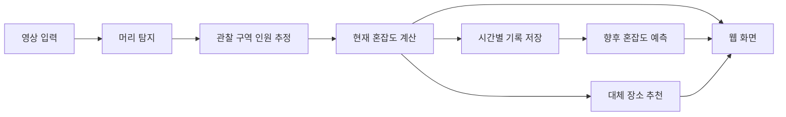

# Campus Pulse

> 캠퍼스 공간의 혼잡도를 확인하고, 덜 붐비는 시간과 장소를 찾는 서비스

**2026 첨단 AI 해커톤 · 4인 팀**

개발 기간: 2026년 11월 5일 16:30 ~ 11월 6일 11:30 (KST, 총 19시간)

현재 서비스 기획 및 학습 환경 구성 단계입니다. 아래 서비스 기능은 개발 계획이며, 대회 세부 주제에 따라 조정될 수 있습니다. 프로젝트 이름은 가칭입니다.

## 저장소 받기

```bash
git clone https://github.com/rnxodnd/campus_pulse.git
cd campus_pulse
```

## 프로젝트 소개

5공학관 식당, 그린에너지관 10층 등 캠퍼스 내 특정 공간에 사람이 몰리면, 직접 방문한 뒤에야 이용하기 어렵다는 사실을 알게 됩니다.

Campus Pulse는 영상에서 **사람의 머리를 탐지해 관찰 구역의 인원을 추정**하고, 이를 웹에서 혼잡도로 보여주는 서비스입니다. 시간별 기록을 바탕으로 방문 시점을 안내하고, 이용 목적에 맞는 대체 장소를 추천하는 것을 목표로 합니다.

## 주요 기능

모든 항목은 구현 예정입니다.

| 기능 | 내용 |
| --- | --- |
| 머리 기반 인원 추정 | 영상에서 머리 영역을 탐지하고, 지정한 관찰 구역의 인원을 추정합니다. |
| 실시간 혼잡도 계산 | 장소별 기준에 따라 현재 상태를 **여유 / 보통 / 포화**로 구분합니다. |
| 웹 시각화 | 장소별 혼잡도와 갱신 시각을 표시하고, 혼잡도에 비례하는 사람 캐릭터 효과를 제공합니다. |
| 방문 시간 예측 | 시간별 혼잡도 기록을 활용해 향후 혼잡도와 방문하기 좋은 시간대를 추정합니다. |
| 대체 장소 추천 | 이용 목적과 장소별 혼잡도를 고려해 다른 공간을 안내합니다. |

### 혼잡도와 빈자리의 구분

머리 탐지 결과는 **관찰 구역의 추정 인원**을 나타냅니다. 이것만으로 정확한 빈자리 수나 가방으로 맡아 둔 좌석을 판단할 수는 없습니다.

초기 아이디어에 포함된 가방 등 소지품 탐지와 좌석 점유 판정은 별도 검토 항목입니다. 혼잡도 분류 기준도 장소의 특성과 영상에서 보이는 범위를 고려해 설정할 예정입니다.

## 처리 흐름



영상 입력 방식은 실제 CCTV 접근 가능 여부에 따라 결정합니다. 녹화 영상을 사용하는 경우에는 재생 영상 기반 결과임을 표시하고, 실시간 관측 결과와 구분합니다.

## 모델 학습 방향

팀이 직접 학습 데이터를 구성하고 학습·평가를 수행해 **머리 탐지에 맞춘 모델**을 만드는 것을 목표로 합니다.

현재 우선 검토하는 방식은 **기존 YOLO 구조와 사전학습 가중치를 활용한 파인튜닝**입니다. 직접 수집하고 라벨링한 영상으로 학습하며, 모델 버전과 초기 가중치 사용 여부는 대회 규정 및 학습 환경 확인 후 확정합니다.

- **탐지 대상:** `head` 단일 클래스
- **데이터 구성:** 실제 적용할 카메라 구도와 유사한 영상에서 프레임 추출
- **라벨링:** 머리 영역을 bounding box로 표시하고, 가림·화면 경계에 대한 기준 통일
- **장면 구성:** 여유·보통·포화 상태와 사람이 없는 장면 포함
- **데이터 분리:** 촬영 영상 또는 충분히 분리된 시간 구간을 기준으로 학습·검증·테스트 분리
- **검증 원칙:** 거의 동일한 인접 프레임이 학습 데이터와 평가 데이터에 함께 들어가지 않도록 구성

파인튜닝을 선택할 경우 결과물은 기존 구조를 기반으로 팀의 데이터에 맞춰 학습한 모델이며, 새로운 신경망 구조를 설계한 모델과는 구분합니다.

방문 시간 예측은 머리 탐지와 별도의 기능입니다. 기록 데이터 확보 후 예측 방식과 예측 가능한 시간 범위를 결정할 예정입니다.

## 개발 환경

팀 공통 Python 버전은 **3.12**입니다. 아래 파일로 패키지 버전을 공유하며, 각자 자신의 컴퓨터에서 `.venv`를 생성합니다. 학습 방식과 웹 기술 스택은 별도로 확정할 예정입니다.

| 구분 | 구성 | 용도 |
| --- | --- | --- |
| 학습 장비 | Apple Silicon M4 Mac | 모델 학습 및 영상 추론 |
| 실행 장치 | Mac: MPS / GPU 없는 Windows 그램: CPU | 장비별 연산 장치 |
| 언어 | Python 3.12 | 데이터 처리, 학습, 추론 |
| 환경 관리 | `.venv`, pip 또는 uv | 패키지 격리 및 의존성 관리 |
| 딥러닝 | PyTorch 2.9.1, torchvision 0.24.1 | 학습 및 추론 |
| 탐지 프레임워크 | Ultralytics 8.3.253 | YOLOv8 기반 모델 실험 |
| 영상·수치 처리 | OpenCV 4.12.0.88, NumPy 2.2.6 | 프레임 추출 및 데이터 처리 |
| 데이터 설정 | PyYAML 6.0.3 | 학습 데이터 YAML 생성·읽기 |
| 웹·API 배포 | Cloudflare | 웹 화면 및 혼잡도 API 배포 예정 |
| 배포 도구 | Node.js 24, Wrangler 4.157.0 | Cloudflare 개발·배포 준비 |
| 저장소 후보 | Cloudflare D1, R2 | 혼잡도 기록 및 파일 보관, 검토 중 |
| 협업 | Git, GitHub | 소스 및 작업 관리 |

초기 환경은 macOS Apple Silicon(arm64)과 Windows x64를 대상으로 합니다. Mac에서는 CUDA가 아닌 MPS를 사용합니다. 모델의 학습 시간과 입력 해상도·배치 크기는 실제 학습 측정 후 정합니다.

### GitHub에 함께 올릴 환경 파일

| 파일 | 역할 |
| --- | --- |
| `.python-version` | Python 3.12 지정 |
| `pyproject.toml` | 직접 사용하는 패키지와 지원 환경 정의 |
| `uv.lock` | 직접·간접 의존성의 정확한 버전 고정 |
| `requirements.txt` | 잠금 파일에서 생성한 pip 설치 목록 |
| `.gitignore` | 가상환경, 데이터, 학습 결과 등의 커밋 제외 |
| `scripts/check_environment.py` | Python 버전, 패키지, MPS/CPU 기본 연산 확인 |

`.venv/` 자체는 업로드하지 않습니다. 이 폴더는 운영체제와 설치 경로에 종속되므로 환경 파일을 이용해 각 컴퓨터에서 다시 생성합니다.

### 방법 1: pip로 설치

먼저 [Python 공식 배포판](https://www.python.org/downloads/)에서 **Python 3.12**를 설치합니다. M4 Mac은 ARM64로 실행되는 Python을 사용합니다. 아래 명령은 저장소 최상위 폴더에서 실행합니다.

**Mac M4**

```bash
python3.12 -m venv .venv
source .venv/bin/activate
python -m pip install --upgrade pip
python -m pip install -r requirements.txt
python -m pip check
python scripts/check_environment.py --device mps
```

**Windows 그램 — PowerShell**

```powershell
py -3.12 -m venv .venv
.\.venv\Scripts\python.exe -m pip install --upgrade pip
.\.venv\Scripts\python.exe -m pip install -r requirements.txt
.\.venv\Scripts\python.exe -m pip check
.\.venv\Scripts\python.exe scripts/check_environment.py --device cpu
```

Windows 명령은 가상환경의 Python을 직접 실행하므로 별도의 활성화 스크립트나 실행 정책 변경이 필요하지 않습니다.

### 방법 2: uv로 설치

[uv 0.13.7 이상, 0.14 미만](https://docs.astral.sh/uv/getting-started/installation/)을 설치한 후 실행합니다. 지원되는 uv 버전 범위는 `pyproject.toml`에도 지정되어 있습니다.

```bash
uv sync --locked
uv run --locked python scripts/check_environment.py
```

`uv sync --locked`는 Python 3.12가 없으면 내려받고, `.venv`에 잠금 파일의 패키지를 설치합니다. 점검 스크립트는 사용 가능한 경우 MPS를 선택하고, 그 외에는 CPU를 선택합니다. Mac의 MPS 동작을 반드시 확인하려면 `--device mps`를 추가합니다.

두 설치 방법 중 하나를 사용합니다. 패키지 버전은 같은 `uv.lock`에서 관리합니다.

### 패키지 목록 변경

담당자가 `pyproject.toml`의 의존성을 수정했다면 다음 명령으로 잠금 파일과 `requirements.txt`를 함께 갱신합니다.

```bash
uv lock
uv export --locked --format requirements-txt --no-dev --no-hashes --no-emit-project --output-file requirements.txt
```

세 파일을 함께 커밋합니다. `requirements.txt`는 자동 생성 파일이므로 직접 수정하지 않습니다. [uv의 잠금·동기화 방식](https://docs.astral.sh/uv/concepts/projects/sync/)

### Mac 학습 안내

데이터 폴더 구성, 머리 라벨링 형식, MPS 학습, 중단한 학습 재개, 테스트 및 추론 방법은 별도 텍스트 파일인 **[docs/training_mac.txt](docs/training_mac.txt)**에 정리했습니다.

### 환경 검증 범위

- Mac M4 / Python 3.12.16: 고정 의존성 설치와 의존성 충돌 검사 완료
- PyTorch MPS 기본 행렬 연산, torchvision NMS, OpenCV 변환, Ultralytics import 확인
- Windows x64: 의존성 해결 및 배포 파일 확인, 실제 Windows 실행은 별도 확인 필요
- 실제 데이터로 학습하거나 모델 정확도를 측정한 상태는 아님

## Cloudflare 배포 준비

학습은 **Mac의 Python 3.12 환경**에서 진행합니다. Cloudflare에는 웹 화면과 혼잡도 조회·수신 API를 배포할 계획입니다. Python 학습용 `requirements.txt`는 Cloudflare Worker의 배포 패키지 목록이 아닙니다.

권장 역할 분담은 다음과 같습니다. 저장소와 API 세부 구성은 아직 확정 전입니다.

| 위치 | 역할 |
| --- | --- |
| Mac M4 | 모델 학습, 영상 추론, 인원·혼잡도 결과 생성 |
| Cloudflare Pages 또는 Workers Static Assets | 웹 화면 제공 |
| Cloudflare Workers | 분석 결과 수신 및 장소별 현황 API |
| Cloudflare D1 — 권장 후보 | 장소, 관측 시각, 인원, 혼잡도 기록 |
| Cloudflare R2 — 권장 후보 | 팀 공유용 영상·데이터셋·모델 파일 |

실시간 추론도 Mac에서 실행하는 구성이라면 Mac과 전송 프로세스가 켜져 있어야 현재 혼잡도가 계속 갱신됩니다. 학습 데이터는 로컬 디스크에서 읽고, 공유·백업할 파일을 객체 저장소에 업로드하는 방식을 권장합니다.

### Cloudflare 도구 설치

[Node.js](https://nodejs.org/) **24.x**를 설치합니다. 검증한 버전은 `.node-version`에 기록되어 있습니다. Cloudflare CLI인 Wrangler는 프로젝트의 `package.json`과 `package-lock.json`으로 버전을 고정합니다.

```bash
node --version
npm ci
npm run cf:version
```

이후 Cloudflare 작업을 시작할 때 본인의 계정으로 로그인합니다.

```bash
npm run cf:login
```

현재는 배포 도구만 준비한 상태이며, 웹 빌드 및 Worker 코드는 없습니다. 실제 배포 명령과 Cloudflare 설정은 코드와 대상 프로젝트가 확정된 후 추가합니다. 계정 토큰, `.dev.vars`, `.env`는 커밋하지 않습니다.

Wrangler의 공식 지원 운영체제는 macOS 13.5 이상과 Windows 11 등입니다. [Wrangler 설치 안내](https://developers.cloudflare.com/workers/wrangler/install-and-update/)

### 저장소 검토

영상과 모델 파일은 객체 저장소에, 장소·시간별 혼잡도 기록은 데이터베이스에 저장합니다. Cloudflare를 사용할 예정이므로 R2와 D1을 권장 후보로 둡니다. MinIO 사용 여부는 확정하지 않았습니다.

기존 오픈소스 MinIO는 현재 유지보수 종료가 안내되어 있으므로 새로 도입하기 전에 운영 방식과 배포판을 확인해야 합니다. [MinIO 공식 안내](https://www.min.io/legal), [R2 API](https://developers.cloudflare.com/r2/api/), [D1](https://developers.cloudflare.com/d1/)

## 평가 계획

| 평가 항목 | 확인할 내용 |
| --- | --- |
| 탐지 품질 | 머리 탐지의 Precision, Recall, mAP |
| 인원 추정 | 실제 인원과 추정 인원의 평균 절대 오차(MAE) |
| 혼잡도 분류 | 사전에 정한 기준 대비 여유·보통·포화 단계 일치율 |
| 처리 성능 | 영상 처리 속도와 관측부터 화면 표시까지의 지연 |

허용 오차와 갱신 주기는 대상 장소 및 사용 목적에 맞춰 정합니다. 성능 수치는 별도 테스트 데이터에서 측정한 뒤 기록합니다.

## 진행 현황

- [ ] 대회 세부 주제 및 사전학습 모델 사용 규정 확인
- [ ] 대상 장소와 영상 입력 방식 확정
- [x] Python 3.12 공유 환경 구성 및 Mac M4 기본 실행 검증
- [ ] 머리 데이터 수집, 라벨링, 데이터 분리
- [ ] 모델 학습 및 평가
- [ ] 혼잡도 계산과 웹 시각화 연결
- [ ] 방문 시간 예측 및 대체 장소 추천 구현
- [ ] 통합 테스트와 발표 준비

## 실행 안내

현재 저장소에는 환경 구성 파일과 점검 스크립트가 있습니다. 모델 학습 및 서비스 코드는 아직 없으며, 환경 점검 성공은 학습 성능이나 탐지 정확도 검증을 의미하지 않습니다.

데이터 준비 방법, 학습 명령 및 서비스 실행 방법은 해당 코드가 추가되면 안내할 예정입니다.
