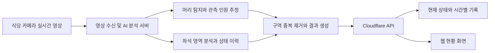

# Campus Pulse

> 5공학관 식당의 실시간 인원과 이용 가능한 좌석을 확인하는 서비스

**2026 첨단 AI 해커톤 · 4인 팀 · 논의 정리 기준 2026년 11월 5일**

개발 기간: **2026년 11월 5일 16:30 ~ 11월 6일 11:30 (KST, 총 19시간)**

이 README는 현재까지의 기획, 환경 구성, 분석 기준과 파트별 작업 방향을 정리한 문서입니다. **확정된 요구사항, 제안된 설계, 실제 구현 상태를 구분**합니다. 현재 저장소에는 환경 설정과 점검 스크립트, 파트별 작업 폴더가 있으며 서비스 및 모델 학습 코드는 아직 구현되지 않았습니다.

바로가기: [AI 담당 작업](ai/README.md) · [백엔드 담당 작업](backend/README.md) · [프론트엔드 담당 작업](frontend/README.md) · [개발 환경](#개발-환경) · [먼저 결정할 사항](#먼저-결정할-사항)

## 프로젝트 범위

식당에 도착한 뒤에야 자리가 없다는 것을 알게 되어 발생하는 헛걸음과 대기를 줄이는 것이 목표입니다. 카메라의 실시간 영상을 분석 서버로 전송하고, 머리 탐지와 좌석 상태 분석 결과를 웹으로 제공합니다.

| 항목 | 현재 결정 |
| --- | --- |
| 대상 공간 | **5공학관 식당 한 곳** |
| 전체 좌석 | **300석**. 팀이 현장 정보로 제공한 수치이며 사진에서 자동 집계한 결과가 아님 |
| 현재 범위에서 제외 | 도서관 열람실, 그린에너지관, 스포츠센터 및 다른 시설 |
| 핵심 분석 | 머리 기반 인원 추정, 사람·짐에 따른 좌석 점유 분석, 혼잡도 표시 |
| 영상 처리 방향 | 실시간 영상을 AI 분석 서버로 전송하여 처리 |
| 학습 환경 | Mac M4, Python 3.12 |
| 웹·API 배포 방향 | Cloudflare |
| 팀 구성 | 프론트엔드 1명, 백엔드 1명, AI 설계·학습 2명 |

카메라 종류·대수·고정 위치·전송 방식, 운영 중 추론 서버의 위치, 모델과 데이터셋의 최종 선정은 아직 미정입니다. 대회 세부 주제와 데이터·모델 사용 규정에 따라 구현 범위가 조정될 수 있습니다.

## 기능과 우선순위

다음 기능은 모두 **구현 계획**입니다.

| 구분 | 기능 | 내용 |
| --- | --- | --- |
| 핵심 | 현재 인원 추정 | 머리를 탐지하여 촬영 범위 내 착석·대기·이동 인원을 추정 |
| 핵심 | 좌석 상태 분석 | 좌석별 사람 점유, 짐 점유, 빈자리와 판단 불확실 상태 구분 |
| 핵심 | 혼잡도 표시 | 사전에 정한 기준으로 여유·보통·포화 표시. 관측 불가·오래된 정보는 별도 표시 |
| 핵심 | 웹 현황 | 총 300석, 확인된 빈자리, 좌석 상태별 수, 관측 범위와 마지막 갱신 시각 제공 |
| 검토 | 일시 비움 처리 | 자리를 사용하던 사람이 배식 등으로 이동한 경우의 상태 유지·복귀 판단 |
| 추가 표현 | 사람 캐릭터 효과 | 관측한 혼잡도에 비례하는 시각 효과. 실제 좌석 수와 구분 |
| 후속 검토 | 방문 시간 예측 | 시간별 기록을 확보한 뒤 예측 방법과 기간 결정 |
| 후속 제안 | 식당 내 여유 구역 안내 | 기존 대체 장소 추천 아이디어를 단일 식당 범위에 맞춰 조정하는 안 |

방문 예측과 구역 추천의 해커톤 내 구현 여부는 확정되지 않았습니다. 다른 시설 추천은 현재 범위에 포함하지 않습니다.

## 현장 사진에서 확인한 사항

팀이 식당 내부를 네 방향에서 촬영한 사진을 공유했습니다. **사진 네 장이 고정 카메라 네 대를 의미하지는 않습니다.**

- 일반 식탁, 높은 바 테이블, 원형·소형 테이블 등 좌석 형태가 섞여 있습니다.
- 기둥, 모니터, 테이블과 의자 등받이가 일부 좌석을 가립니다. 머리가 보여도 좌석 위 짐은 보이지 않을 수 있습니다.
- 먼 좌석은 작고 서로 겹쳐 보입니다. 실제 고정 카메라 영상에서 식별 가능한 범위를 확인해야 합니다.
- 테이블의 검은 휴지함 등 고정 비품이 짐으로 오인되는지 검증해야 합니다.

구역과 좌석마다 고유 ID를 부여하고 실제 배치와 대조하여 전체 300석을 등록하는 방향을 제안합니다. 여러 카메라에 보이는 같은 좌석은 한 번만 집계합니다. **전체 좌석, 관측 가능한 좌석, 현재 판단 가능한 좌석을 구분**하고, 사각지대의 좌석은 빈자리로 간주하지 않습니다. 사진 원본과 정확한 좌석 배치도는 현재 저장소에 포함하지 않았습니다.

## 인원과 좌석을 구분하는 원칙

**현재 인원과 점유 좌석은 서로 다른 지표이며 합산하지 않습니다.**

- 인원은 촬영 범위 안의 사람을 셉니다. 짐은 사람 수에 더하지 않습니다.
- 점유는 좌석 ID 기준으로 셉니다. 한 좌석에 사람과 짐이 함께 있어도 1석입니다.
- 사람이 이동하며 들고 있는 짐은 그 자체로 좌석을 점유하지 않습니다.
- 전체 머리 수에는 배식 대기·이동 인원이 포함되므로 `300 - 머리 수`를 빈자리 수로 사용하지 않습니다.
- 여러 카메라의 머리 수를 단순 합산하면 같은 사람이 중복될 수 있습니다. 카메라별 집계 구역 또는 중복 제거 방법을 정해야 합니다.
- 프레임마다 나온 인원을 누적한 값은 현재 인원이 아닙니다. 화면에는 관측 시점의 추정 인원을 표시합니다.

### 좌석 상태 설계안

아래 상태명은 파트 간 협의를 위한 초안이며, 아직 코드나 API로 구현되지 않았습니다. 좌석 하나는 같은 시점에 하나의 상태만 가집니다.

| 상태 | 의미 | 바로 이용 가능한 좌석 수에 포함 |
| --- | --- | --- |
| `available` | 사람과 짐이 없고 이용 가능하다고 확인한 좌석 | 포함 |
| `person_occupied` | 사람이 사용 중인 좌석. 짐이 함께 있어도 한 번만 집계 | 제외 |
| `belongings_occupied` | 사람은 없고 놓인 짐이 자리를 차지하는 좌석 | 제외 |
| `temporarily_away` | 사용 이력과 신뢰할 수 있는 추적 등 합의한 조건으로 일시 비움으로 판단한 좌석 | 제안상 제외 |
| `unknown` | 가림, 영상 누락, 추적 단절 또는 판단 불확실 상태 | 제외하고 별도 표시 |

일시 비움의 판정 조건·유지 시간·해제 기준과 추적 방식은 미정입니다. **이동 이력만으로 자리 예약 권리나 복귀 의도를 확정하지 않습니다.** 조건이 충족되지 않는 일시 비움 후보는 `unknown`으로 구분하는 방향을 제안합니다.

### 짐과 이동 상황 처리

| 상황 | 인원 처리 | 좌석 처리 원칙 |
| --- | --- | --- |
| 사람과 짐이 같은 자리에 있음 | 사람 1명 | 해당 좌석 1석만 점유 |
| 짐을 자리에 두고 실내에서 이동 | 같은 사람은 인원에 한 번만 포함 | 기존 좌석은 짐 점유 |
| 짐을 두고 공간 밖으로 나감 | 퇴장이 확인되면 현재 인원에서 제외 | 짐이 남은 좌석은 계속 짐 점유 |
| 입장 후 짐을 들고 바로 배식 줄에 섬 | 대기 인원으로 포함 | 사용 이력이 없는 좌석을 배정하거나 점유로 추가하지 않음 |
| 사용하던 자리에서 짐까지 들고 배식하러 감 | 실내에 있으면 현재 인원에 포함 | 기존 좌석의 일시 비움 후보. 이력·추적·운영 기준으로 판단 |
| 일시 비움 상태에서 같은 자리로 복귀 | 사람을 중복 집계하지 않음 | 사람 점유로 전환 |
| 이동 경로나 좌석 상태를 확인할 수 없음 | 확인 가능한 범위만 표시 | 빈자리로 단정하지 않고 확인 불가 처리 |

가방이 좌석 영역과 잠깐 겹치거나 사람이 가방을 든 채 정지했다는 사실만으로 짐 점유를 확정하지 않습니다. 휴대 중인지 좌석에 놓였는지 구분할 데이터와 검증이 필요합니다. 영상에서 머리가 사라졌다는 사실만으로 퇴장했다고 판단하지 않습니다.

### 점유율과 가중치

좌석 이용 가능성 기준에서는 **사람 점유와 짐 점유의 가중치를 모두 1**로 둡니다. 짐 점유의 가중치를 낮춰 실제보다 빈자리가 많아 보이게 만들지 않습니다.

모든 좌석을 확인했고 일시 비움·확인 불가 상태가 없는 경우:

```text
점유율 = (사람 점유 좌석 + 짐만 있는 점유 좌석) / 전체 좌석 × 100
바로 이용 가능한 좌석 = available 상태의 좌석 수
```

예를 들어 전체 300석 중 사람 점유가 180석, 짐만 있는 점유가 30석이고 나머지가 모두 확인된 빈자리라면 점유율은 70%, 빈자리는 90석입니다. **이 수치는 설명용 예시이며 현장 측정 결과가 아닙니다.**

관측이 불완전하면 확인한 구역의 점유율과 관측 범위를 함께 표시하거나 전체 점유율을 미확정으로 둡니다. 일시 비움은 물리적인 점유와 구분하여 별도로 표시하고, 최종 점유율 반영 방식은 팀에서 확정합니다.

초기에는 좌석 점유율을 혼잡도 판단의 기본 지표로 사용하고 배식 대기 상태를 별도로 보여주는 안을 우선 검토합니다. 전체 머리 수와 좌석 점유율을 다시 가중 합산하여 같은 이용 상황을 중복 반영하지 않도록 합니다. **여유·보통·포화의 임계값, 대기 지표 가중치와 상태 전환 유예 시간은 아직 정하지 않았습니다.**

## 목표 처리 흐름



실시간 영상은 AI 분석 서버로 전달하고, 웹에는 인원·좌석 상태 등의 분석 결과를 제공하는 방향입니다. 원본 영상을 사용자 웹에 공개하는 기능은 현재 계획에 포함하지 않습니다.

- 영상 전송 프로토콜, 해상도, 분석 주기, API 전송 주기와 화면 갱신 주기는 미정입니다.
- Mac M4는 학습 장비로 정했습니다. 운영 추론도 Mac에서 할지 별도 서버에서 할지는 정하지 않았습니다.
- 녹화 영상으로 시험하면 재생 영상 기반 결과임을 표시합니다. 예시 데이터와 실제 실시간 관측을 구분합니다.
- 갱신이 끊기면 최신 관측 시각과 지연 상태를 표시합니다. 데이터가 없다는 이유로 0명·빈자리 300석을 생성하지 않습니다.

## 데이터와 모델 학습 방향

팀이 직접 데이터 구성, 라벨링, 학습과 평가를 수행하여 현장에 맞는 모델을 만드는 것이 목표입니다. **머리 탐지와 좌석 상태 분석은 별도 과제**로 다룹니다.

### 외부 데이터와 자체 수집 데이터

대회에 외부 데이터 활용 기준이 있다는 정보를 공유받았습니다. 해당 문구만으로 자체 수집이 금지된다고 단정할 수는 없지만, **외부 데이터 인정 범위, 자체 수집·추가 데이터 허용 여부와 사전학습 모델 사용 조건은 규정 원문 확인이 필요**합니다.

| 데이터 | 활용 계획 | 현재 상태 |
| --- | --- | --- |
| AI Hub 실내외 군중 특성 데이터 | 머리 탐지용 학습 데이터 후보 | 공개 설명 검토만 완료. 원본 다운로드·변환·학습 미실행 |
| 식당 자체 촬영 영상 | 실제 카메라 구도에 맞춘 추가 학습과 검증 | 네 방향 현장 사진 확인. 학습용 영상·라벨 구성은 미완료 |
| 좌석별 상태 데이터 | 빈자리, 사람 점유, 놓인 짐과 휴대 중인 짐 등 구분 | 자체 라벨링 범위와 데이터 확보 방법 결정 필요 |

AI Hub의 [실내외 군중 특성 데이터 71368](https://www.aihub.or.kr/aihubdata/data/view.do?aihubDataSe=data&dataSetSn=71368)는 다음과 같이 검토했습니다.

- **1세부 CCTV 데이터:** 머리 점 좌표가 제공됩니다. 점 좌표를 그대로 YOLO 머리 박스 정답으로 사용할 수는 없습니다.
- **2세부 시나리오 데이터:** 머리 bounding box가 있으며 JSON의 `bbox`는 `[left, top, width, height]` 형식입니다. YOLO 라벨 형식으로의 변환·검증이 필요합니다.
- 공개 스키마에는 사람의 자세 등의 속성이 있지만, 좌석 위치·좌석 점유·짐 점유 라벨은 확인되지 않았습니다. 이 데이터만으로 좌석 분석까지 학습할 수 있다고 가정하지 않습니다.
- 소개된 활용 모델은 군중 위치·인원 예측용 IIM과 이동 경로 예측용 PECNet입니다. AI Hub 배포 파일의 학습 완료 가중치 포함 여부와 현재 Mac 환경 호환성은 확인하지 않았습니다.

AI Hub는 활용 모델을 참고용 시범 자료로 안내합니다. 데이터 이용 신청·승인과 이용 조건을 확인하며, 원본 이미지·라벨을 GitHub나 공개 객체 저장소에 재배포하지 않습니다. [AI Hub FAQ](https://www.aihub.or.kr/aihubnews/faq/list.do), [이용정책](https://aihub.or.kr/intrcn/guid/usagepolicy.do?currMenu=151&topMenu=105)

카메라 설치 승인, 촬영 안내, 영상 저장 여부·접근 권한·보관 기간도 실제 운영 전에 정해야 합니다.

### 모델 선택 검토

COCO는 데이터셋이고 YOLO는 탐지 모델 계열입니다. 데이터셋 선택, 모델 버전 선택, 사전학습 가중치 사용 여부는 각각 구분합니다. 데이터·모델·코드의 이용 조건과 별도 호스팅 서비스의 요금도 구분해서 확인합니다.

| 방식 | 의미 | 현재 판단 |
| --- | --- | --- |
| 기존 구조와 사전학습 가중치 미세조정 | 기존 가중치를 시작점으로 팀의 데이터에 맞춰 학습 | **YOLOv8n을 우선 검토**. 규정 확인과 실제 측정 후 최종 결정 |
| 기존 구조를 무작위 초기화하여 학습 | 구조는 재사용하지만 학습된 가중치 없이 시작 | 선택 가능하나 19시간 안의 수렴·정확도는 보장하지 않음 |
| 새로운 신경망 구조 설계 | 구조부터 설계·학습·평가 | 이번 일정의 우선 방식으로 채택하지 않음 |
| AI Hub 활용 모델 직접 도입 | 제공 코드와 모델을 현재 환경에 맞춰 사용 | 호환성 검증 필요. 머리 탐지와 별개로 좌석 분석 추가 필요 |

IIM의 [원본 구현](https://github.com/taohan10200/IIM)은 Python 3.7·PyTorch 1.6 환경을 안내합니다. 현재 Python 3.12·MPS 환경에 바로 적용된다고 가정하지 않으며, AI Hub 배포본은 별도 확인 대상입니다.

머리 탐지는 `head` 단일 클래스 박스 탐지를 검토합니다. 좌석 분석은 고정 영상에서 지정한 좌석 영역을 분류하는 경량 모델과 시간에 따른 상태 처리를 우선 제안합니다. 두 모델의 최종 구조, 추적기, 입력 크기와 학습 설정은 미정입니다.

### 데이터 구성과 평가 원칙

- 실제 카메라 구도와 비슷한 영상에서 프레임을 추출하고 머리·좌석 라벨링 기준을 통일합니다.
- 빈 장면, 붐비는 장면, 가림, 작은 머리, 고정 비품, 짐 점유, 짐을 들고 이동하는 장면을 포함합니다.
- 촬영 영상 또는 충분히 분리된 시간 구간을 먼저 학습·검증·테스트로 나눕니다. 인접 프레임을 무작위로 섞어 평가를 부풀리지 않습니다.
- 미세조정 결과는 기존 구조를 기반으로 직접 학습한 모델입니다. 새로운 모델 구조를 발명했다는 의미로 표현하지 않습니다.
- 학습 시간과 처리 속도는 Mac M4에서 실제 측정하며, 문서의 예시 epoch나 배치 크기를 검증 결과로 취급하지 않습니다.

## 팀 역할과 폴더별 작업

담당자는 공유된 기획서 초안을 기준으로 작성했습니다. AI 내부의 세부 작업 배분은 제안이며 두 담당자가 협의하여 확정합니다.

| 담당 | 인원 | 폴더 | 주요 책임 |
| --- | --- | --- | --- |
| 변민석·구태웅 | 2명 | [ai](ai/README.md) | 머리 탐지·데이터 학습, 좌석 상태·이력 처리, 추론 결과 생성 |
| 김경렬 | 1명 | [backend](backend/README.md) | 분석 결과 수신, 상태·기록 관리, 조회 API와 Cloudflare 연동 |
| 김민정 | 1명 | [frontend](frontend/README.md) | 식당·구역 현황 화면, API 연결, 상태·갱신 시각 표시 |

```text
campus_pulse/
├── ai/                       # AI 담당 작업 안내. 기능 코드는 아직 없음
├── backend/                  # 백엔드 담당 작업 안내. 기능 코드는 아직 없음
├── frontend/                 # 프론트엔드 담당 작업 안내. 기능 코드는 아직 없음
├── docs/training_mac.txt     # Mac 학습 절차와 명령 예시
├── scripts/check_environment.py
├── pyproject.toml
├── uv.lock
├── requirements.txt
├── package.json              # 현재는 Cloudflare 배포 도구만 포함
└── README.md
```

### 파트 간 먼저 합의할 정보

아래 필드는 **연동 초안이며 실제 API 명세가 아닙니다.** AI·백엔드·프론트엔드 담당자가 함께 확정하고 변경 내용을 공유합니다.

| 필드 | 의미 |
| --- | --- |
| `facility_id` | 식당 식별자. 제안값 `engineering5_cafeteria` |
| `observed_at` | 분석 대상 영상의 관측 시각. UTC ISO 8601 형식 제안 |
| `people_count` | 관측 범위 내 추정 인원. 확인 불가이면 `null`; 0명과 구분 |
| `total_seats` | 시설 전체 좌석 수 300 |
| `seat_counts` | 위 다섯 좌석 상태별 개수. 전체 좌석을 표현할 때 합계 300, 미관측 좌석은 `unknown` |
| `congestion_level` | `low`, `medium`, `high`, `unknown` 초안. 임계값 미정 |

부분 관측 여부·구역 정보, 영상 수신 상태, 마지막 수신 시각과 정보 만료 기준도 합의해야 합니다. `people_count`는 식당 전체를 관측한 값인지 일부 구역의 값인지 구분해서 전달·표시합니다. 좌석 ID의 중복 제거와 최신 관측 선택은 어느 파트가 담당할지 한 곳으로 정합니다.

## 저장소 받기

```bash
git clone https://github.com/rnxodnd/campus_pulse.git
cd campus_pulse
```

기존 저장소에서 팀원의 변경을 가져올 때는 먼저 로컬 변경을 확인합니다.

```bash
git status
git pull --ff-only origin main
```

위 pull 명령은 로컬 `main`에서 실행하는 예시입니다. 수정 중인 파일이나 브랜치 분기가 있으면 상태를 확인해 병합 방식을 정하고, 다른 사람의 변경을 덮어쓰는 강제 push는 하지 않습니다.

## 개발 환경

팀 공통 Python 버전은 **3.12**입니다. 아래 파일로 패키지 버전을 공유하며, 각자 자신의 컴퓨터에서 저장소 최상위에 `.venv`를 생성합니다. `ai` 폴더로 역할을 나눴다고 가상환경을 폴더마다 만들 필요는 없습니다. 프론트엔드 프레임워크와 백엔드 세부 구성은 아직 미정입니다.

| 구분 | 구성 | 용도 |
| --- | --- | --- |
| 학습 장비 | Apple Silicon M4 Mac | 모델 학습 및 로컬 추론 검증. 운영 추론 서버 위치는 미정 |
| 실행 장치 | Mac: MPS / GPU 없는 Windows 그램: CPU | 장비별 연산 장치 |
| 언어 | Python 3.12 | 데이터 처리, 학습, 추론 |
| 환경 관리 | `.venv`, pip 또는 uv | 패키지 격리 및 의존성 관리 |
| 딥러닝 | PyTorch 2.9.1, torchvision 0.24.1 | 학습 및 추론 |
| 탐지 프레임워크 | Ultralytics 8.3.253 | YOLOv8 기반 모델 실험 |
| 영상·수치 처리 | OpenCV 4.12.0.88, NumPy 2.2.6 | 프레임 추출 및 데이터 처리 |
| 데이터 설정 | PyYAML 6.0.3 | 학습 데이터 YAML 생성·읽기 |
| 웹·API 배포 | Cloudflare | 웹 화면 및 혼잡도 API 배포 예정 |
| 배포 도구 | Node.js 24, Wrangler 4.157.0 | Cloudflare 개발·배포 준비 |
| 저장소 후보 | Cloudflare D1, R2 | 혼잡도 기록 및 파일 보관, 검토 중 |
| 협업 | Git, GitHub | 소스 및 작업 관리 |

초기 환경은 macOS Apple Silicon(arm64)과 Windows x64를 대상으로 합니다. Mac에서는 CUDA가 아닌 MPS를 사용합니다. 모델의 학습 시간과 입력 해상도·배치 크기는 실제 학습 측정 후 정합니다.

### GitHub에 함께 올릴 환경 파일

| 파일 | 역할 |
| --- | --- |
| `.python-version` | Python 3.12 지정 |
| `pyproject.toml` | 직접 사용하는 패키지와 지원 환경 정의 |
| `uv.lock` | 직접·간접 의존성의 정확한 버전 고정 |
| `requirements.txt` | 잠금 파일에서 생성한 pip 설치 목록 |
| `.gitignore` | 가상환경, 데이터, 학습 결과 등의 커밋 제외 |
| `scripts/check_environment.py` | Python 버전, 패키지, MPS/CPU 기본 연산 확인 |

**`requirements.txt`는 패키지 목록이며 가상환경을 자동 생성하지 않습니다.** pip를 쓰면 가상환경을 먼저 만들고 활성화하거나 그 안의 Python을 직접 실행해야 합니다. 저장소 전체와 uv를 준비했다면 아래 방법 2의 `uv sync --locked`가 Python 3.12 준비, `.venv` 생성과 패키지 설치를 처리합니다.

`.venv/` 자체는 업로드하지 않습니다. 이 폴더는 운영체제와 설치 경로에 종속되므로 환경 파일을 이용해 각 컴퓨터에서 다시 생성합니다. 이미 `.venv`가 있다면 매번 다시 만들지 않고 사용합니다. 두 설치 방법 중 하나를 선택합니다.

### 방법 1: pip로 설치

먼저 [Python 공식 배포판](https://www.python.org/downloads/)에서 **Python 3.12**를 설치합니다. M4 Mac은 ARM64로 실행되는 Python을 사용합니다. 아래 명령은 저장소 최상위 폴더에서 실행합니다.

**Mac M4**

```bash
python3.12 -m venv .venv
source .venv/bin/activate
python -m pip install --upgrade pip
python -m pip install -r requirements.txt
python -m pip check
python scripts/check_environment.py --device mps
```

**Windows 그램 — PowerShell**

```powershell
py -3.12 -m venv .venv
.\.venv\Scripts\python.exe -m pip install --upgrade pip
.\.venv\Scripts\python.exe -m pip install -r requirements.txt
.\.venv\Scripts\python.exe -m pip check
.\.venv\Scripts\python.exe scripts/check_environment.py --device cpu
```

Windows 명령은 가상환경의 Python을 직접 실행하므로 별도의 활성화 스크립트나 실행 정책 변경이 필요하지 않습니다.

### 방법 2: uv로 설치

[uv 0.13.7 이상, 0.14 미만](https://docs.astral.sh/uv/getting-started/installation/)을 설치한 후 실행합니다. 지원되는 uv 버전 범위는 `pyproject.toml`에도 지정되어 있습니다.

```bash
uv sync --locked
uv run --locked python scripts/check_environment.py
```

`uv sync --locked`는 Python 3.12가 없으면 내려받고, `.venv`에 잠금 파일의 패키지를 설치합니다. 점검 스크립트는 사용 가능한 경우 MPS를 선택하고, 그 외에는 CPU를 선택합니다. Mac의 MPS 동작을 반드시 확인하려면 `--device mps`를 추가합니다.

두 설치 방법 중 하나를 사용합니다. 패키지 버전은 같은 `uv.lock`에서 관리합니다.

### 패키지 목록 변경

담당자가 `pyproject.toml`의 의존성을 수정했다면 다음 명령으로 잠금 파일과 `requirements.txt`를 함께 갱신합니다.

```bash
uv lock
uv export --locked --format requirements-txt --no-dev --no-hashes --no-emit-project --output-file requirements.txt
```

세 파일을 함께 커밋합니다. `requirements.txt`는 자동 생성 파일이므로 직접 수정하지 않습니다. [uv의 잠금·동기화 방식](https://docs.astral.sh/uv/concepts/projects/sync/)

### Mac 학습 안내

데이터 폴더 구성, 머리 라벨링 형식, MPS 학습, 중단한 학습 재개, 테스트 및 추론 방법은 별도 텍스트 파일인 **[docs/training_mac.txt](docs/training_mac.txt)**에 정리했습니다.

Mac에서 터미널을 새로 열었을 때 기존 가상환경을 사용하는 방법은 다음과 같습니다. 저장소 최상위에서 실행합니다.

```bash
source .venv/bin/activate
python scripts/check_environment.py --device mps
```

활성화 없이 `uv run --locked python scripts/check_environment.py --device mps`로 실행할 수도 있습니다. 학습 안내의 명령은 실행 예시이며, 현재 데이터가 준비되었거나 학습이 완료되었다는 의미가 아닙니다.

### 환경 검증 범위

- Mac M4 / Python 3.12.16: 고정 의존성 설치와 의존성 충돌 검사 완료
- PyTorch MPS 기본 행렬 연산, torchvision NMS, OpenCV 변환, Ultralytics import 확인
- Windows x64: 의존성 해결 및 배포 파일 확인, 실제 Windows 실행은 별도 확인 필요
- 실제 데이터로 학습하거나 모델 정확도를 측정한 상태는 아님

## Cloudflare 배포 준비

학습은 **Mac의 Python 3.12 환경**에서 진행합니다. Cloudflare에는 웹 화면과 분석 결과 조회·수신 API를 배포할 계획입니다. Python 학습용 `requirements.txt`는 Cloudflare Worker의 배포 패키지 목록이 아닙니다. 현재 어떤 서비스도 배포 완료로 표시하지 않습니다.

권장 역할 분담은 다음과 같습니다. 저장소와 API 세부 구성은 아직 확정 전입니다.

| 위치 | 역할 |
| --- | --- |
| Mac M4 | 모델 학습과 로컬 추론 검증 |
| AI 분석 서버 — 위치 미정 | 실시간 영상 수신, 머리·좌석 분석, 시각이 포함된 결과 생성 |
| Cloudflare Pages 또는 Workers Static Assets | 웹 화면 제공 |
| Cloudflare Workers | 분석 결과 수신 및 식당·구역 현황 API |
| Cloudflare D1 — 권장 후보 | 시설·구역·좌석 정보와 시각별 분석 결과 |
| Cloudflare R2 — 권장 후보 | 보관·공유 권한을 확인한 파일과 모델 산출물 |

실시간 추론도 Mac에서 실행하는 구성을 선택한다면 Mac과 영상 수신·분석·전송 프로세스가 계속 실행되어야 갱신됩니다. 학습 데이터는 우선 로컬 디스크에서 읽습니다. 객체 저장소 업로드는 데이터별 이용 조건과 접근 범위를 확인한 뒤 결정하며, AI Hub 원본을 공개 공유하는 용도로 사용하지 않습니다.

### Cloudflare 도구 설치

[Node.js](https://nodejs.org/) **24.x**를 설치합니다. 검증한 버전은 `.node-version`에 기록되어 있습니다. Cloudflare CLI인 Wrangler는 프로젝트의 `package.json`과 `package-lock.json`으로 버전을 고정합니다.

```bash
node --version
npm ci
npm run cf:version
```

이후 Cloudflare 작업을 시작할 때 본인의 계정으로 로그인합니다.

```bash
npm run cf:login
```

현재는 배포 도구만 준비한 상태이며, 웹 빌드 및 Worker 코드는 없습니다. 실제 배포 명령과 Cloudflare 설정은 코드와 대상 프로젝트가 확정된 후 추가합니다. 계정 토큰, `.dev.vars`, `.env`는 커밋하지 않습니다.

Wrangler의 공식 지원 운영체제는 macOS 13.5 이상과 Windows 11 등입니다. [Wrangler 설치 안내](https://developers.cloudflare.com/workers/wrangler/install-and-update/)

### 저장소 검토

MinIO 도입도 논의했지만 저장소 제품은 확정하지 않았습니다. Cloudflare 배포 방향에 맞춰 파일은 R2, 숫자·상태 기록은 D1을 후보로 검토합니다. 영상 원본을 반드시 저장하는 구조로 확정한 것은 아닙니다. [R2 API](https://developers.cloudflare.com/r2/api/), [D1](https://developers.cloudflare.com/d1/)

MinIO를 선택하려면 현재 배포판과 유지보수 상태, 서버 운영 부담을 별도로 확인합니다. [MinIO 공식 안내](https://www.min.io/legal)

## 평가 계획

| 평가 항목 | 확인할 내용 |
| --- | --- |
| 머리 탐지 | Precision, Recall, mAP와 가림·작은 머리의 누락 |
| 인원 추정 | 동일 관측 범위의 실제 인원 대비 평균 절대 오차(MAE), 카메라 중복 |
| 좌석 상태 | 상태별 오분류, 특히 사용 중인 좌석을 빈자리로 안내하는 오류 |
| 관측 범위 | 전체 300석 중 관측·판정 가능한 범위와 확인 불가 좌석 수 |
| 이동 상황 | 짐을 둔 이동, 짐을 들고 배식, 복귀, 추적 단절, 퇴장 시나리오 |
| 혼잡도 분류 | 합의한 기준 대비 단계 일치율과 경계에서 잦은 상태 변경 |
| 처리 성능 | 영상 처리 속도, 관측부터 화면 표시까지의 지연, 전송 중단 처리 |

허용 오차와 갱신 주기는 대상 장소 및 사용 목적에 맞춰 정합니다. 성능 수치는 별도 테스트 데이터에서 측정한 뒤 기록합니다.

## 먼저 결정할 사항

1. 카메라 대수·고정 위치와 300석 중 실제 관측 범위, 구역·좌석 ID 배치
2. 실시간 영상 송출·수신 방식과 운영 추론 서버의 위치
3. 외부 데이터 활용 기준 원문, 자체 수집·사전학습 가중치 허용 범위, 데이터 접근 승인
4. 머리 모델과 좌석 모델, 데이터 라벨링 기준, AI 두 담당자의 세부 분담
5. 일시 비움의 증거·유지·해제 조건과 추적 실패 처리, 혼잡도 임계값
6. AI 결과 형식, 중복 제거 담당, API, 갱신·만료 주기, 저장소 선택
7. 영상 보관·접근 범위, 추가 기능과 최종 시연 범위

## 진행 현황

- [x] 5공학관 식당 한 곳, 총 300석으로 범위 확정
- [x] 실시간 영상을 서버로 전송해 분석하는 방향 결정
- [x] 네 방향 현장 사진으로 배치와 가림 요소 검토
- [x] Python 3.12 공유 환경 구성 및 Mac M4 기본 실행 검증
- [x] Cloudflare 배포 도구 설정
- [x] AI Hub 공개 모델·라벨 설명 검토
- [x] `ai`, `backend`, `frontend` 폴더 구성과 파트별 작업 안내
- [ ] 대회 데이터·모델 사용 규정 원문 확인
- [ ] 카메라·영상 전송·좌석 배치·운영 추론 서버 확정
- [ ] 외부 데이터 확보와 실제 파일 검증, 현장 영상 수집·라벨링·데이터 분리
- [ ] 모델 학습·추론·좌석 상태 처리 구현과 평가
- [ ] 분석 결과 수신 API와 웹 현황 연결
- [ ] 통합 테스트, 배포 및 발표 준비

## 실행 안내

현재 실행할 수 있는 것은 환경 점검과 Cloudflare 도구 명령입니다. `ai`, `backend`, `frontend`에는 작업 안내 문서만 있으며 모델 학습 파이프라인·API·웹 앱의 실행 코드는 아직 없습니다. 환경 점검 성공은 학습 성능이나 탐지 정확도 검증을 의미하지 않습니다.

머리 데이터 준비와 학습 명령 예시는 [Mac 학습 안내](docs/training_mac.txt)를 참고합니다. 실제 서비스 실행·배포 명령은 담당자가 코드를 추가한 뒤 각 폴더의 README에 기록합니다.
